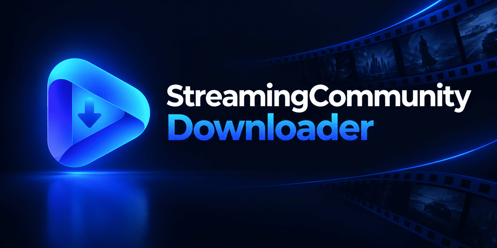
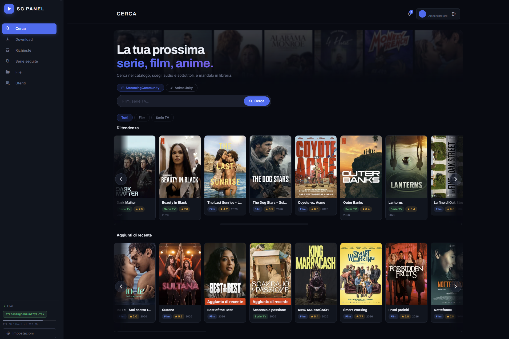

<p align="center">
  
</p>

<p align="center">
  <b>Un'interfaccia web per esplorare, guardare e scaricare film e serie TV per uso personale.</b><br/>
  Supporta riproduzione diretta in streaming, salvataggio della posizione di visione ("Continua a guardare"), download con ripresa automatica (resume), gestione multi-utenza e organizzazione della libreria multimediale.
</p>

<p align="center">
  <a href="#-guida-allinstallazione"></a>
  <a href="#-crediti-e-disclaimer"></a>
</p>

---

## 📌 Panoramica

FilmViewer è un'applicazione web leggera pensata per uso personale e domestico tra amici e familiari. Offre:
- **Catalogo & Home:** Esplorazione rapida di film e serie TV con locandine, schede informative e dettagli completi.
- **Continua a Guardare:** Salvataggio automatico del progresso di visione ogni 5 secondi. Riprendi da dove eri rimasto, ricomincia da capo o rimuovi i contenuti già visti direttamente dalla Home.
- **Web Player Integrato:** Streaming immediato ad alta risoluzione nel browser con supporto al multi-streaming contemporaneo su più dispositivi.
- **Sistema Multi-utenza & Ruoli:** Autenticazione sicura locale (password con hash bcrypt). Gli amministratori possono creare e gestire account per amici e parenti (ruolo Admin con pieni poteri e ruolo Utente Base con streaming e gestione autonoma delle proprie richieste).
- **Download con Ripresa (Resume):** Download multi-thread con FFmpeg e recupero istantaneo dei segmenti interrotti.
- **Gestione Richieste & Pulizia Automatica:** Gestione autonoma dei download da "Le mie richieste". L'eliminazione di un film scaricato rimuove fisicamente il file dal disco e ripulisce le cartelle vuote.

<p align="center">
  
</p>

---

## 🚀 Guida all'Installazione

### 🏠 CasaOS (Home Server / NAS)

Puoi installare FilmViewer su CasaOS in due modi: direttamente dall'interfaccia grafica (consigliato) oppure via terminale.

#### Metodo 1: Dall'interfaccia web di CasaOS (Consigliato)

1. Nella dashboard principale di CasaOS, clicca sul pulsante **"+"** (in alto a destra nella sezione App) e seleziona **"Installa un'applicazione personalizzata"** (*Install a customized app*).
2. In alto a destra della finestra popup, clicca sul pulsante **"Importa"** (icona del codice `</>` o icona file accanto alla `X`).
3. Incolla il seguente codice Docker Compose completo:

```yaml
name: filmviewer
services:
  filmviewer:
    image: ghcr.io/pitstop13/filmviewer:latest
    container_name: filmviewer-panel
    ports:
      - "9876:9876"
    volumes:
      # Cartella host sul tuo server per salvare i film/serie (modifica se usi un altro percorso)
      - /DATA/Storage/nas/Download-Film:/app/videos
      # Configurazione, database utenti e cronologia persistenti
      - /DATA/AppData/FilmViewer/config:/app/config
    environment:
      - HOST=0.0.0.0
      - PORT=9876
      - VIDEOS_DIR=/app/videos
      - DB_FILE=/app/config/panel.db
      - DATA_FILE=/app/config/data.json
      - SCHEDULE_FILE=/app/config/schedule.json
      - COOKIE_SECURE=0
      - COOKIE_SAMESITE=lax
      - TRUST_PROXY_HEADERS=0
    restart: unless-stopped
    x-casaos:
      ports:
        - container: "9876"
          description:
            en_us: Porta interfaccia Web FilmViewer
      volumes:
        - container: /app/videos
          description:
            en_us: Cartella video e download
        - container: /app/config
          description:
            en_us: Configurazione e database
x-casaos:
  architectures:
    - amd64
    - arm64
    - arm
  main: filmviewer
  description:
    en_us: Web interface to stream and download movies and TV series for personal use.
    it_it: Interfaccia web per guardare e scaricare film e serie TV con ripresa automatica dei download.
  tagline:
    en_us: Streaming & Downloader
    it_it: Streaming & Downloader
  developer: FilmViewer
  author: PitStop13
  icon: https://raw.githubusercontent.com/PitStop13/FilmViewer/main/docs/logo.png
  thumbnail: https://raw.githubusercontent.com/PitStop13/FilmViewer/main/docs/logo.png
  title:
    en_us: FilmViewer
  index: /
  port_map: "9876"
```

4. Clicca su **"Invia"** (*Submit*). Grazie ai metadati `x-casaos`, tutti i campi (Nome, Icona, Porta Web, Volumi ed Environment) saranno precompilati in automatico!
   - **Logo / Icona:** se compili a mano o vuoi cambiare l'icona, incolla questo URL nel campo Icona:  
     `https://raw.githubusercontent.com/PitStop13/FilmViewer/main/docs/logo.png`
   - **Cartella video Host:** assicurati che il percorso dell'host montato su `/app/videos` (es. `/DATA/Media/FilmViewer/videos` o `/DATA/Media/Movies`) sia quello dove vuoi archiviare i file.
5. Clicca su **"Installa"** e attendi il completamento del download dell'immagine.
6. L'applicazione sarà subito accessibile cliccando sull'icona di FilmViewer nella dashboard o all'indirizzo: 👉 **`http://<IP-DEL-TUO-SERVER>:9876`**

#### Metodo 2: Da Terminale (o SSH)

Se preferisci usare la riga di comando o compilare il codice sorgente direttamente:
```bash
cd /DATA/AppData
git clone https://github.com/PitStop13/FilmViewer.git
cd FilmViewer
docker compose up -d --build
```
L'applicazione sarà raggiungibile su: 👉 **`http://<IP-DEL-TUO-SERVER>:9876`**

---

### 🪟 Windows (10 / 11)

#### Opzione 1: Con Docker Desktop (Consigliato)
1. Apri **PowerShell** o **Terminale** e clona la repo:
   ```powershell
   git clone https://github.com/PitStop13/FilmViewer.git
   cd FilmViewer
   ```
2. Avvia il container:
   ```powershell
   docker compose up -d --build
   ```
3. Apri il browser su: 👉 **`http://localhost:9876`**

#### Opzione 2: Con Python (Senza Docker)
1. Installa **Python 3.11+** e **FFmpeg**.
2. Esegui nel terminale:
   ```powershell
   pip install -r requirements.txt
   python main.py
   ```
3. Apri il browser su: 👉 **`http://localhost:9876`**

---

### 🍏 macOS (Apple Silicon & Intel)

#### Opzione 1: Con Docker Desktop
```bash
git clone https://github.com/PitStop13/FilmViewer.git
cd FilmViewer
docker compose up -d --build
```
Apri il browser su: 👉 **`http://localhost:9876`**

#### Opzione 2: Senza Docker (Homebrew)
```bash
brew install python ffmpeg git
git clone https://github.com/PitStop13/FilmViewer.git
cd FilmViewer
pip3 install -r requirements.txt
python3 main.py
```
Apri il browser su: 👉 **`http://localhost:9876`**

---

## 🎯 Configurazione al Primo Avvio

Quando accedi per la prima volta a **`http://<IP-SERVER>:9876`** (o `http://localhost:9876` in locale):

1. **Creazione Account Amministratore:**
   - Alla prima apertura verrà mostrata la schermata di configurazione iniziale per creare il tuo account **Admin**.
   - Inserisci un nome utente e una password sicura. Questo account avrà pieni permessi di gestione.
   - Una volta completato il setup, potrai effettuare il login.

2. **Gestione Utenti (Multi-utenza):**
   - Dall'account amministratore, entra in **Impostazioni → Utenti** per creare ulteriori profili per amici o familiari.
   - Puoi assegnare a ciascun utente il ruolo di **Amministratore** o di **Utente Base**.
   - Gli utenti base possono effettuare l'accesso contemporaneo, vedere i contenuti in streaming, salvare il proprio stato in "Continua a guardare" e gestire i propri download senza toccare i file di sistema o le impostazioni globali.

3. **Cartella video (Percorso di download):**
   > ⚠️ **IMPORTANTE SE USI DOCKER O CASAOS:**  
   > Nel campo del percorso video **lascia o inserisci esattamente `/app/videos`** (il valore predefinito).  
   > **NON inserire percorsi dell'host come `/DATA/...` o `C:\...`**: l'applicazione viene eseguita all'interno di un container Docker che riconosce unicamente il percorso interno `/app/videos`. Questo percorso è già collegato in automatico tramite i volumi alla tua cartella reale sul disco/NAS. Se modifichi `/app/videos` con un percorso dell'host, il container non potrà accedervi e i download restituiranno errore.

---

## 📜 Crediti e Disclaimer

### Crediti & Progetto Originale
Questo progetto è basato ed estende il codice di **Edoardo Fiore**, autore del repository open source [StreamingCommunity-downloader](https://github.com/EdoardoFiore/StreamingCommunity-downloader), concesso sotto licenza [MIT](https://github.com/EdoardoFiore/StreamingCommunity-downloader/blob/main/LICENSE).

### Progetto Personale & Non Commerciale
- Questo software è sviluppato e mantenuto **esclusivamente per uso personale, privato e senza fini di lucro**.
- **Non è un prodotto commerciale:** non contiene annunci pubblicitari, non vende nulla e non prevede abbonamenti, donazioni obbligatorie o monetizzazione di alcun genere.

### Disclaimer Legale
Questo software è un client sviluppato a scopo puramente didattico, di studio e di ricerca sui protocolli di streaming HLS e sull'elaborazione multimediale.  
Il programma **non memorizza, non ospita, non ritrasmette e non distribuisce alcun file multimediale o materiale protetto da copyright**. Tutti i flussi e le informazioni vengono richiesti direttamente dai server pubblicamente accessibili sul web.  
L'utente finale è l'unico responsabile dell'utilizzo dello strumento e del rispetto delle normative sul diritto d'autore vigenti nel proprio paese.
