<p align="center">
  
</p>

<p align="center">
  <b>Un pannello web self-hosted per cercare, visualizzare e scaricare film, serie TV e anime direttamente nella tua libreria Jellyfin.</b><br/>
  Coda richieste, monitoraggio automatico nuove uscite, notifiche Discord/Telegram, server MCP per agenti AI e file manager integrato.
</p>

---

## 📸 Anteprime

<p align="center">
  
</p>
<p align="center">
  <sub><b>Home Page</b> — Catalogo aggiornato con le copertine e le novità direttamente dalle piattaforme supportate.</sub>
</p>

### Ricerca & Dettagli

<table>
  <tr>
    <td width="50%" valign="top">
      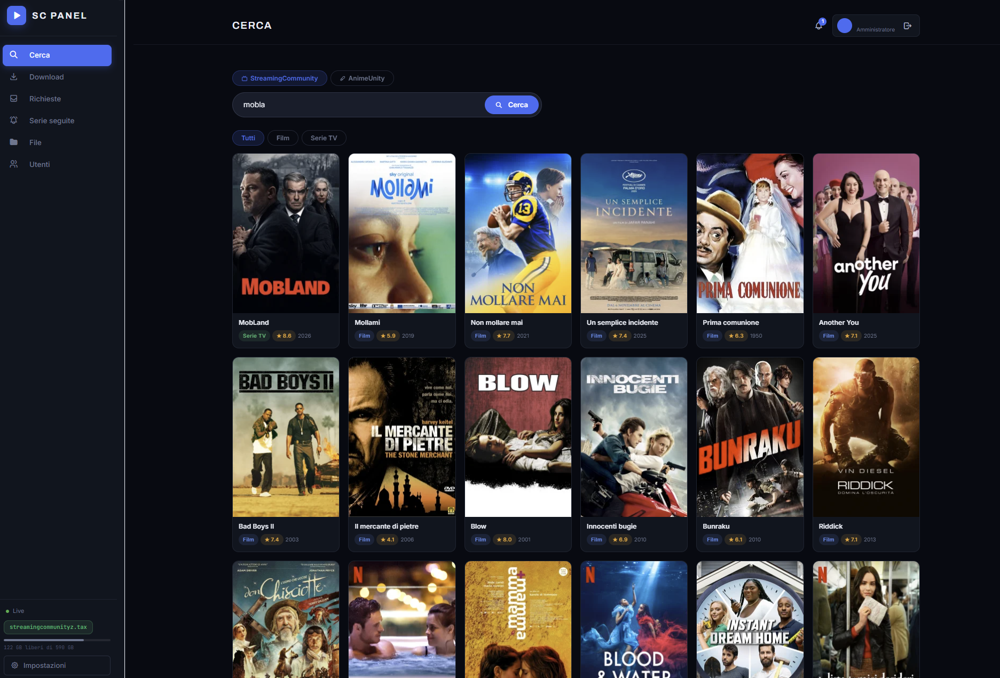<br/>
      <sub><b>Ricerca unificata</b> — Film, serie TV e anime da StreamingCommunity e AnimeUnity con stato del contenuto visibile direttamente sulla scheda.</sub>
    </td>
    <td width="50%" valign="top">
      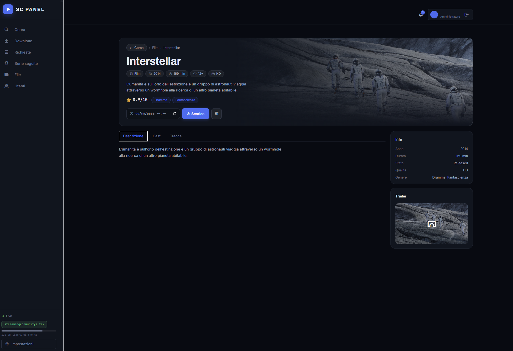<br/>
      <sub><b>Scheda titolo</b> — Trama, generi, valutazione IMDb, artwork e trailer estratti direttamente dalla sorgente, senza bisogno di API key esterne (TMDB).</sub>
    </td>
  </tr>
  <tr>
    <td width="50%" valign="top">
      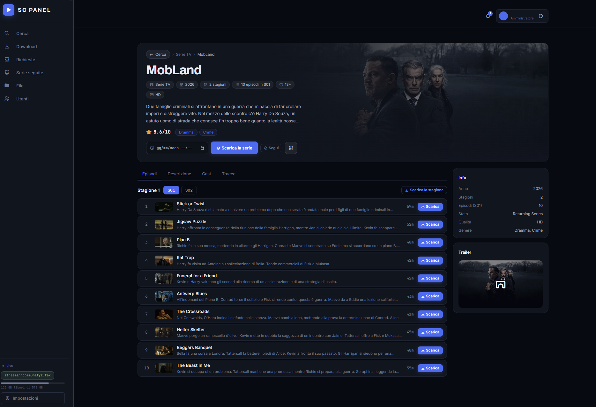<br/>
      <sub><b>Gestione stagioni</b> — Selezione episodi con verifica reale delle tracce audio e dei sottotitoli disponibili per ciascuna puntata.</sub>
    </td>
    <td width="50%" valign="top">
      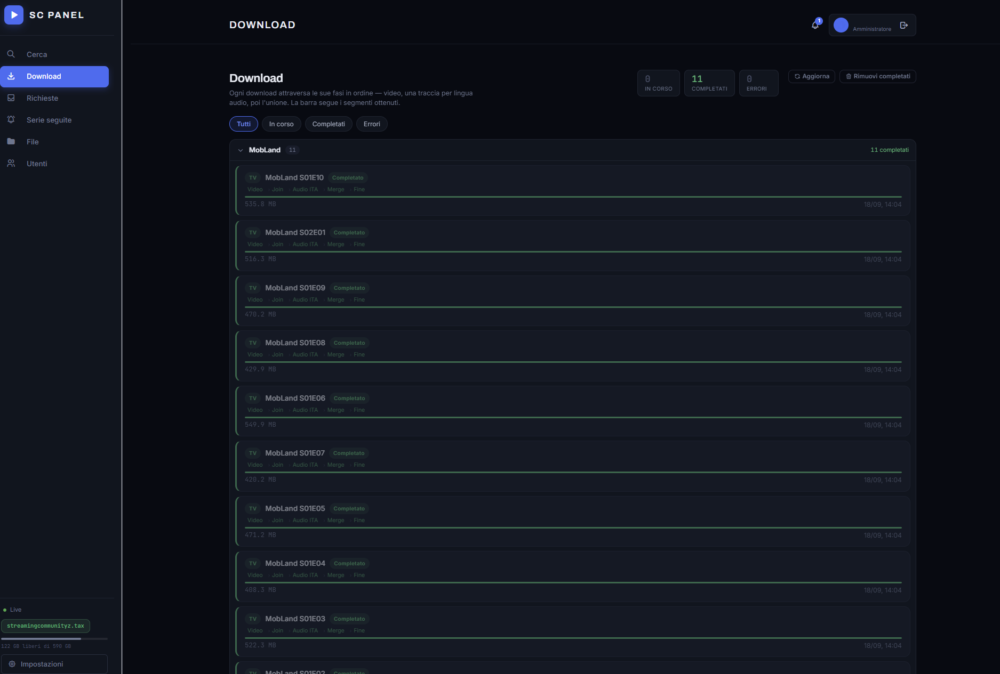<br/>
      <sub><b>Download live</b> — Avanzamento in tempo reale per fase (download video → tracce audio → unione FFmpeg) con velocità, ETA e opzioni di pausa/annulla.</sub>
    </td>
  </tr>
</table>

### Coda Richieste & Monitoraggio

<table>
  <tr>
    <td width="50%" valign="top">
      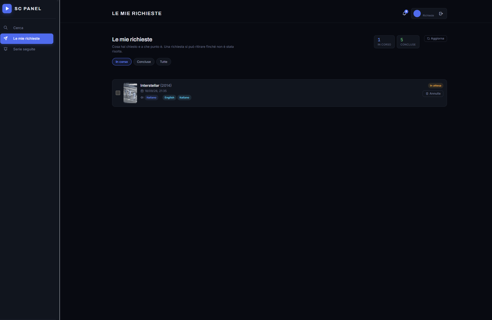<br/>
      <sub><b>Le mie richieste</b> — Portale richieste stile Overseerr/Jellyseerr: gli utenti chiedono contenuti che finiscono nella coda di approvazione.</sub>
    </td>
    <td width="50%" valign="top">
      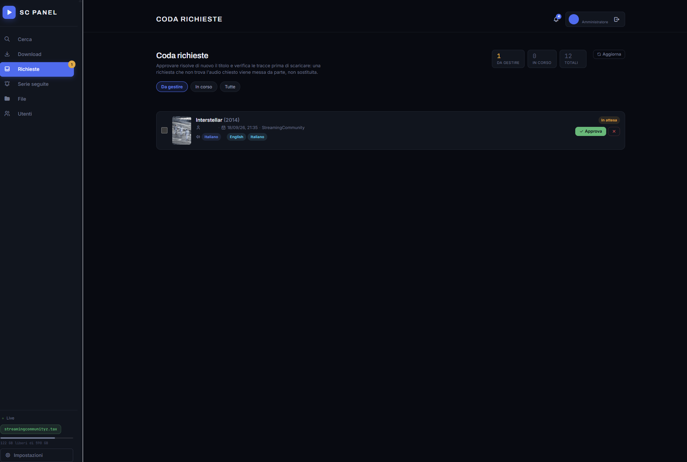<br/>
      <sub><b>Approvazione amministratore</b> — L'approvazione ricalcola i flussi e verifica la lingua audio richiesta prima di avviare il job.</sub>
    </td>
  </tr>
  <tr>
    <td colspan="2" align="center" valign="top">
      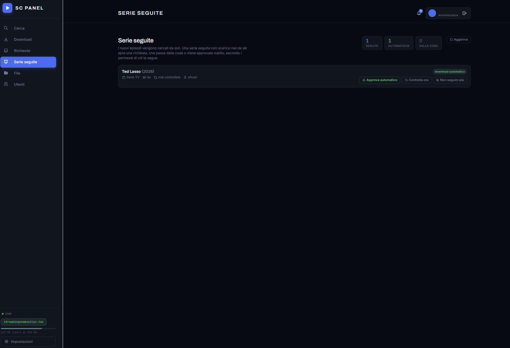<br/>
      <sub><b>Serie e Anime Seguiti</b> — Il sistema cerca periodicamente nuove puntate. Quando esce un episodio, genera una richiesta o lo scarica automaticamente in base ai permessi dell'utente.</sub>
    </td>
  </tr>
</table>

### Gestione & Sistema

<table>
  <tr>
    <td width="50%" valign="top">
      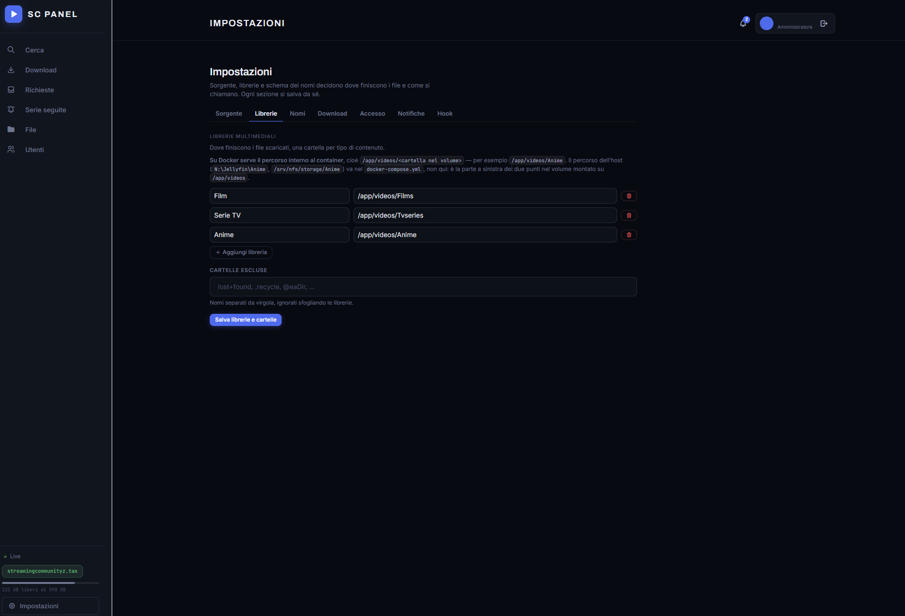<br/>
      <sub><b>Impostazioni complete</b> — Gestione cartelle libreria, formati di esportazione, template nomi file, notifiche Apprise e hook post-download.</sub>
    </td>
    <td width="50%" valign="top">
      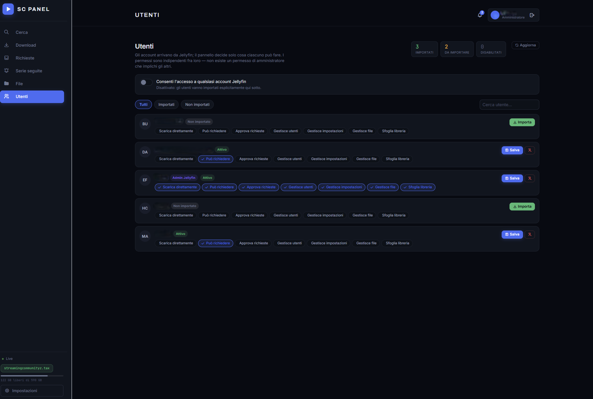<br/>
      <sub><b>Utenti & Permessi</b> — Sincronizzazione utenti con Jellyfin SSO: permessi indipendenti e granulari senza password locali aggiuntive.</sub>
    </td>
  </tr>
  <tr>
    <td width="50%" valign="top">
      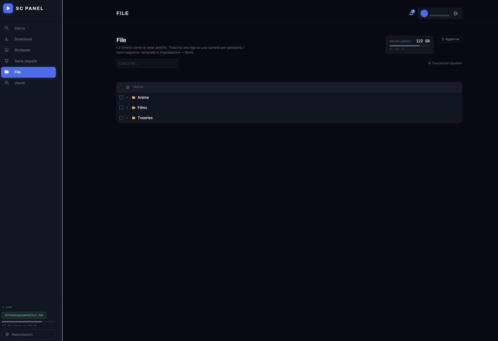<br/>
      <sub><b>File Manager integrato</b> — Navigazione tra le cartelle dei video, eliminazione, rinomina, streaming video in-browser e monitoraggio spazio disco.</sub>
    </td>
    <td width="50%" valign="top">
      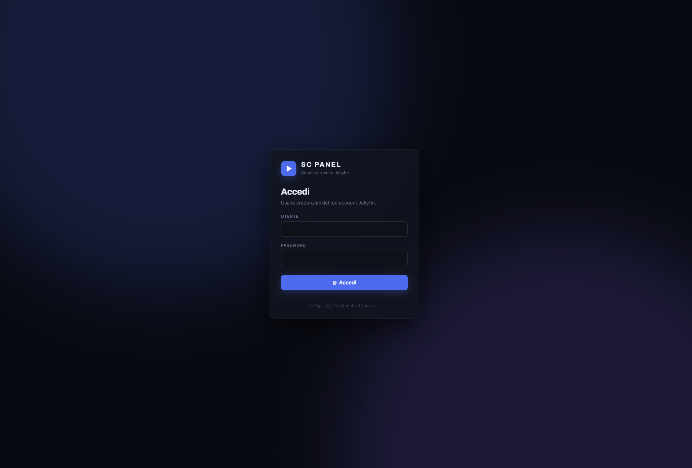<br/>
      <sub><b>Login flessibile</b> — Accesso tramite Jellyfin oppure modalità aperta ("Continua senza Jellyfin") scelta al primo avvio.</sub>
    </td>
  </tr>
</table>

---

## ⚡ Caratteristiche Principali

- **Streaming Diretto ("Guarda Subito"):** Riproduzione immediata di film, serie ed episodi tramite Web Player integrato in popup modal con pulsante di fallback per aprire direttamente la pagina di streaming ufficiale su StreamingCommunity o AnimeUnity.
- **Doppia Sorgente Integrata:** Ricerca simultanea su **StreamingCommunity** e **AnimeUnity** con catalogazione automatica.
- **Auto-Discovery e Domain Recovery:** Algoritmo avanzato con protezioni anti-SSRF che rileva se il dominio di streaming è bloccato e individua automaticamente l'indirizzo funzionante da una fonte sicura, proponendone l'adozione o applicandolo da solo.
- **Motore di Download HLS / M3U8:**
  - Parsing delle playlist master e delle rendition HLS.
  - Download parallelo dei segmenti video `.ts` con riprova esponenziale.
  - Decifratura al volo dei flussi protetti da **AES-128-CBC**.
  - Unione ed esportazione tramite **FFmpeg** in container `.mkv` o `.mp4` senza ricodifica (stream copy rapido e perdita zero di qualità).
  - Gestione multitraccia: download selettivo di tracce audio (italiano, originale, ecc.) e sottotitoli sincronizzati (`.vtt` o muxati).
- **Integrazione Jellyfin Nativa & Configurazione Iniziale:**
  - **Wizard di Setup:** Scelta guidata al primo avvio con selezione della **cartella di salvataggio dei download** e possibilità di collegare Jellyfin (SSO) o usare la modalità aperta ("Continua senza Jellyfin").
  - **Aggiornamento automatico libreria:** Webhook incorporato che forza una scansione di Jellyfin al termine di ogni download.
- **Coda Richieste e Watchlist:**
  - Portale richieste per gli utenti di casa o amici.
  - Serie seguite con polling automatico in background per il download delle nuove uscite.
- **Server MCP (Model Context Protocol):**
  - Espone un endpoint `/mcp` (Streamable HTTP) che consente ad assistenti AI (es. Claude Code, Cursor) di cercare titoli, consultare dettagli, avviare download e gestire la coda richieste con autenticazione basata su Bearer token crittograficamente sicuro.
- **Privacy e Zero Telemetria:**
  - Nessun tracker, nessun cookie di terze parti, nessun dato telemetrico inviato all'esterno.
  - Tutte le librerie frontend (Tabler CSS, JS, icone) sono integrate in locale senza dipendenze da CDN esterne.

---

## 🚀 Guida all'Installazione

### Opzione 1: Con Docker Compose (Consigliata)

Assicurati di avere [Docker](https://www.docker.com/) e Docker Compose installati.

1. **Clona la repository:**
   ```bash
   git clone https://github.com/tuo-utente/FilmViewer.git
   cd FilmViewer
   ```

2. **Avvia il container:**
   ```bash
   docker compose up -d --build
   ```

3. **Apri il pannello nel browser:**
   Collegati a: **`http://localhost:9876`**

Al primo avvio apparirà il **Wizard di Configurazione**:
- Scegli la **cartella di salvataggio** (default `/app/videos`).
- Clicca **"Collega a Jellyfin"** se hai un server Jellyfin: inserisci l'indirizzo del server e le credenziali di un utente amministratore.
- Oppure clicca **"Continua senza Jellyfin"** se desideri usare il pannello in modalità aperta senza autenticazione.

---

### Opzione 2: Installazione su CasaOS

CasaOS permette di installare e gestire il pannello in pochi istanti.

#### Metodo da Interfaccia Web CasaOS:
1. Nella schermata principale di CasaOS, fai clic sul pulsante **"+"** (Installa applicazione personalizzata).
2. Fai clic su **"Importa"** in alto a destra (icona del documento Docker Compose).
3. Incolla la seguente configurazione:

```yaml
version: '3.8'

services:
  web:
    build: .
    container_name: filmviewer
    ports:
      - "9876:9876"
    volumes:
      - /DATA/Media/Videos:/app/videos
      - /DATA/AppData/filmviewer/config:/app/config
    environment:
      - HOST=0.0.0.0
      - PORT=9876
      - VIDEOS_DIR=/app/videos
      - DB_FILE=/app/config/panel.db
      - DATA_FILE=/app/config/data.json
      - SCHEDULE_FILE=/app/config/schedule.json
      - COOKIE_SECURE=0
      - COOKIE_SAMESITE=lax
      - TRUST_PROXY_HEADERS=0
    restart: unless-stopped
    deploy:
      replicas: 1
```

> [!IMPORTANT]
> Assicurati che le cartelle sull'host (`/DATA/AppData/filmviewer/config` e `/DATA/Media/Videos`) esistano e abbiano i permessi di lettura/scrittura corretti.

---

### Opzione 3: Esecuzione Locale (Python)

**Prerequisiti:**
- **Python 3.11** o superiore
- **FFmpeg** installato e presente nel `PATH` di sistema (su Windows è supportato anche il fallback automatico su `imageio-ffmpeg`).

```bash
# 1. Installa le dipendenze
pip install -r requirements.txt

# 2. Avvia l'applicazione
python main.py
```
Il pannello sarà attivo su `http://127.0.0.1:9876`.

Per eseguire la suite di test (richiede `requirements-dev.txt`):
```bash
pip install -r requirements-dev.txt
pytest -q
```

---

## ⚙️ Variabili d'Ambiente

| Variabile | Default | Descrizione |
|---|---|---|
| `HOST` | `127.0.0.1` | Indirizzo IP di bind (in Docker impostare `0.0.0.0`). |
| `PORT` | `9876` | Porta HTTP del server web (default `9876`). |
| `VIDEOS_DIR` | `videos` | Percorso cartella in cui scaricare i filmati (montare su volume). |
| `DB_FILE` | `panel.db` | Percorso database SQLite utenti/sessioni/richieste (`/app/config/panel.db`). |
| `DATA_FILE` | `data.json` | Percorso file di configurazione percorsi e impostazioni runtime. |
| `SCHEDULE_FILE` | `schedule.json`| Registro delle serie e dei download pianificati. |
| `COOKIE_SECURE` | `0` | Impostare a `1` se il pannello è servito sotto HTTPS con certificato SSL valido. |
| `COOKIE_SAMESITE`| `lax` | Policy SameSite dei cookie (`lax`, `strict`, `none`). |
| `TRUST_PROXY_HEADERS` | `0` | Impostare a `1` **SOLO** se ci si trova dietro a un reverse proxy fidato (Nginx, Caddy, Traefik). |
| `FFMPEG_PATH` | *(auto)* | Percorso personalizzato del binario di FFmpeg (se non nel PATH). |

---

## 📁 Struttura Cartelle di Output (Compatibile Jellyfin)

I download vengono organizzati secondo le linee guida ufficiali di denominazione per Jellyfin:

```
videos/
├── Film (2024)/
│   ├── Film (2024).mkv
│   └── Film (2024).it.vtt          # Sottotitoli esterni (se abilitati)
└── Serie TV (2023)/
    └── Season 01/
        ├── Serie TV S01E01.mkv
        └── Serie TV S01E02.mkv
```

Il formato di esportazione predefinito è `.mkv` (supporta tutte le tracce audio/sottotitoli), configurabile anche in `.mp4` dalle impostazioni per dispositivi meno recenti.

---

## 🤖 Integrazione AI con Model Context Protocol (MCP)

Il pannello implementa un server **MCP nativo** su endpoint `/mcp` (trasporto Streamable HTTP).

1. Abilita la funzionalità in **Impostazioni → MCP** e genera il token segreto.
2. Configura il client MCP (ad esempio su Claude Desktop o Claude Code):

```json
{
  "mcpServers": {
    "filmviewer": {
      "type": "http",
      "url": "http://tuo-server:8000/mcp",
      "headers": {
        "Authorization": "Bearer <TUO_TOKEN>"
      }
    }
  }
}
```

Gli agenti AI possono eseguire ricerche, consultare dettagli, pianificare download, approvare richieste e verificare lo stato del sistema rispettando i permessi dell'utente che ha generato il token.

---

## 🔒 Sicurezza e Privacy

- **Nessuna Raccolta Dati:** Il software non raccoglie dati personali, non traccia l'attività degli utenti e non invia statistiche di alcun tipo.
- **Protezione Anti-SSRF:** La ricerca di nuovi domini verifica rigorosamente che gli indirizzi IP non appartengano a reti private, localhost o link-local.
- **Consiglio di Deployment:** Se esponi il pannello su Internet:
  1. Configura un reverse proxy con HTTPS (Caddy, Nginx, Nginx Proxy Manager).
  2. Imposta `COOKIE_SECURE=1` e `TRUST_PROXY_HEADERS=1`.
  3. Evita di lasciare il pannello in modalità "Continua senza Jellyfin" (Open Mode) se raggiungibile pubblicamente senza un sistema di autenticazione a monte (es. Cloudflare Zero Trust, Authelia, Authentik).

---

## 📜 Licenza e Disclaimer

### Licenza
Distribuito con licenza **MIT**. Consulta il file `LICENSE` per maggiori informazioni.

### Disclaimer Legale ed Educativo
Questo progetto è sviluppato ed erogato **esclusivamente a scopo illustrativo ed educativo**. Dimostra l'implementazione pratica di parser M3U8 HLS, algoritmi di decifratura simmetrica AES-CBC, pipeline di elaborazione flussi multimediali tramite FFmpeg e architetture asincrone in Python con FastAPI.

Il progetto **non ospita, non memorizza e non trasmette alcun file audiovisivo o materiale protetto da copyright**. È un mero client che interagisce con pagine e servizi di terze parti pubblicamente accessibili sul web. L'utente finale è l'unico ed esclusivo responsabile del rispetto delle normative sul diritto d'autore vigenti nel proprio Paese e dei termini d'uso delle piattaforme consultate.
